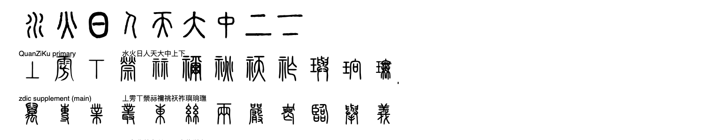

# 小焕的小篆输入法

macOS 上的小篆输入法，走两条路子：

| 路子 | 怎么用 | 例子 |
|---|---|---|
| **拼音输入** | 敲拼音，候选窗以篆形显示 | `shui` → 水 说 税 睡 谁 |
| **部件反查** | 敲部件，反查以这些部件构成的字 | `水工` → 江　`日木` → 杲/杳/果 |

```
拼音 "shui"  ──►  候选窗（水 说 税 睡 …，以篆形显示）  ──►  上屏 U+3EF5E 等小篆字符
部件 "水工"  ──►  反查得「江」  ──►  上屏「江」的真篆形
```

## 它能做什么

- 输入**无声调拼音**（`shui`、`lv`＝`lü`），实时给出候选，按「有篆形优先 + 常用度」排序
- 上屏的是**普通汉字**（BMP）—— 在编辑器里把文字字体设为 `Shuowen Seal` 即显示篆形。
  **故意不用超 BMP 的小篆码位**（`U+3D000+`）：那种字符在没装字体的机器上一律是
  豆腐块，既没法分享、也没法在多数排版软件里正常处理
- 简体字自动经「简 → 繁」规范化后再查篆形（`说→說`、`边→邊`…）；
  字体里也把简体映射到了对应篆形，**打简体照样出篆书**
- **部件反查**：用部件拼键来找字，输出永远是查得到的真篆形（不做字形合成，原因见
  [`compose/README.md`](compose/README.md)）
- **《说文》540 部检索**：按原书部序查某部所辖全部字

## 安装

**下载即用**：[`releases/xiaohuan-xiaozhuan-ime-macOS-v1.0.0.zip`](releases/xiaohuan-xiaozhuan-ime-macOS-v1.0.0.zip)
解压后运行 `./install.sh`。

`install.sh` 会自动做三件事：装输入法、装字体、**把输入法加进系统启用列表**
（等同于点 `+` 添加）。最后一步很关键——只把 `.app` 拷进
`~/Library/Input Methods/` 的话，系统虽认得它，**系统设置里却看不到**。

```bash
# 从源码构建（本项目内）
./build.sh install          # 编译 + 装输入法 + 装字体 + 启用
./build.sh package          # 生成 dist/小焕的小篆输入法-macOS.zip

# 或直接用分发包
unzip 小焕的小篆输入法-macOS.zip && cd 小焕的小篆输入法 && ./install.sh
```

装完到 **系统设置 → 键盘 → 文字输入 → 输入法 → 编辑**，添加「小焕的小篆输入法」。

## 发布到 GitHub

```bash
./tools/publish_release.sh   # 创建 Release 并上传分发包（需读钥匙串里的 token，会弹窗）
```

### 系统设置里找不到？

```bash
python3 tools/enable_inputmethod.py    # 补上「启用」这一步
```

然后**关掉并重开**「系统设置」窗口（那个面板读缓存，装完不重开看不到）。

## Reasonix Skill

本项目已封装成 skill **`xiaozhuan-ime`**（装在 `~/.reasonix/skills/xiaozhuan-ime/`），
把整条链路和踩坑清单固化下来，以后做类似的 macOS 输入法可直接复用：

```
skill:xiaozhuan-ime
  SKILL.md   链路图 + 4 个致命坑 + 验收判据 + 超 BMP 陷阱
  scripts/   build_font / tis_check / enable_inputmethod / acceptance
```

## 验收结果（实机）

在 **WPS Office 空白文档**中实测：


输入 15 个篆字（水火山木人日月明天地大小上下中），**全部正常显示为篆形，无一豆腐块**。
其中「小」来自 PUA 补区（U+F280F），同样正常渲染。

换成全字库字形后，再走一遍系统渲染路径（CoreText）复核：



三行分别是**主区字**、**PUA 补区字**、以及原始字型里**曾经错位、现已修复**的那批字
（巡 咄 甫 角 谷 豕 辰 赤）。

> 注意：WPS 默认字体（Times New Roman / MS 明朝）不含小篆码位，
> 需要把文本字体设为 **Shuowen Seal** 才显示（Word 之外的多数软件同理）。
> 这是超 BMP 字符（U+3D000 在 Plan 3）的固有限制，不是字体本身的问题。

## 验收

```bash
python3 tools/acceptance.py   # 35 项端到端检查
python3 tools/check.py        # 工程自检
```

## 架构

```
core/                     转换内核（纯 Python，可独立使用）
  seal_index.py           SealSources.txt → 现代汉字 ↔ 小篆码位
  pinyin_engine.py        拼音 → 汉字候选（pypinyin 单字字典 + 词频排序）
  freq.py                 字频代理（pypinyin 词组词典统计）
  zhuan.py                统一入口：拼音/汉字 → 小篆
tools/
  fetch_all.py            汉典 SVG 抓取（仅当 fonts/ 素材缺失时才需要重跑）
  export_dict.py          导出 ime/Resources/seal_dict.json
  export_compose_index.py 重建 compose 部件反查索引
  check.py                工程自检
  acceptance.py           端到端验收测试
fonts/                    汉典抓来的 SVG 素材（补缺来源，不入库）
  raw/*.svg               主区：按小篆码位命名
  pua/*.svg               补区：按 PUA 码位命名
font/
  ebas/EBAS-Shuowen.ttf   全字库说文解字原始字型（主字形源）
  build_font.py           全字库 TTF + 汉典 SVG → 小篆字体（U+3D000 主区 + PUA 补区）
ime/
  ShuowenIME/             InputMethodKit 输入法（Swift）
  Resources/              Info.plist、seal_dict.json
compose/                   **部件反查输入法**（敲「水工」出「江」）
  decompose.py            字 → 部件（偏旁归一、去笔画、独体返回空）
  build_index.py          建反查索引
  lookup.py               查询（精确 + 子集匹配）
  cli.py                  命令行入口
  ids.txt                 汉字部件拆解数据

  SPEC.md                 交给模型实现的规格
  README.md               为什么是「反查」而不是「合成」——务必一读
zhuan.py                  拼音转小篆的命令行入口
build.sh                  构建 / 安装 / 卸载
```

## 三个必须知道的坑

**1. Unicode 小篆区块并不完整。** Unicode 18.0 的 `kSEAL_MCJK` 有约 2,918 条把篆形
对应成了**扩展区古字**（例如「二」记作「𠄞」、「五」记作「𢀑」），导致「七」「二」
「五」「小」「之」这类常用字查不到码位。实测 5,195 个常用字里只有 2,211 个有
Unicode 码位 —— 加上补区后，最终能打出 3,984 个（77%）。

> 解决：**补区**。这类字改从字源取篆形（全字库优先，没收的用汉典），
> 用确定性公式编码到 PUA 私有区：
> `PUA = 0xF0000 + (汉字码位 - 0x3400)`（可逆，不需要额外映射表）。
> 代价：**补区字符离开本字体不可移植**——复制到没装该字体的机器会显示成方块。

**2. 没有任何系统字体支持小篆码位。** 本机 659 个字体里只有 `LastResort.otf`
（豆腐块兜底）"碰得到" `U+3D000`。所以字体必须自带，且**必须装到
`~/Library/Fonts/`**——目标 App 是别的进程，只在本进程注册字体没用。

**3. 输入模式的声明方式很反直觉。** 让系统认这个输入法，踩了三层：

| 现象 | 原因 | 解法 |
|---|---|---|
| 系统完全扫不到 | bundle 用 `.inputmethod` 后缀 | 改 `.app`（与 QianwenIME/WeType 一致），**立即生效，不用重登** |
| 扫到了但 `TISTypeKeyboardInputMethodWithoutModes`，切不过去 | `tsInputModeListKey` 直接放在 Info.plist 顶层 | 必须包在 **`ComponentInputModeDict`** 里，且每个模式要有 **`TISInputSourceID`**，并用 `tsVisibleInputModeOrderedArrayKey` 列出顺序（照抄 `/System/Library/Input Methods/AinuIM.app`） |
| 候选/控制器找不到 | Swift 类没有 ObjC 运行时名 | `@objc(SealInputController)` —— Info.plist 的 `InputMethodServerControllerClass` 是由 ObjC runtime 按名字实例化的 |

另外 `CFBundlePackageType` 要写 `APPL`（不是 `IMK`），后台常驻用 `LSUIElement`
而不是 `LSBackgroundOnly`。

## 用法

```bash
# 1. 合成字体（全字库重编码 + 汉典 SVG 补缺，约 15 秒）
python3 font/build_font.py

# 1b. 要分发/商用？换纯全字库版重建（不含汉典字形）
# python3 font/build_font.py --no-zdic

# 2. 导出拼音词典（改动过字形源就要重跑）
python3 tools/export_dict.py
python3 tools/export_compose_index.py   # 部件反查索引（可选）

# 3. 构建 + 安装（同时把字体装到 ~/Library/Fonts/）
./build.sh install

# 4. 自检（关键指标一目了然）
python3 tools/check.py
```

装完后到 **系统设置 → 键盘 → 文字输入 → 输入法 → 编辑**，添加「小篆输入法」，
然后按 Ctrl+Space（或 Fn 键）切过去。

```bash
./build.sh build       # 只构建
./build.sh font        # 只装字体
./build.sh uninstall   # 卸载
```

## 打字方式

| 操作 | 效果 |
|---|---|
| 输入拼音 `shui` | 候选窗显示 `水 说 税 睡 谁 …`（以篆形显示） |
| `1` ~ `9` 或空格 | 选第 N 个候选并上屏小篆字符 |
| `-` / `=` | 上下翻页 |
| 回车 | 上屏拼音原文 |
| Esc | 清空 |

每个候选下方的小红字是它对应的现代汉字，方便对认。

## 命令行内核（不装输入法也能用）

```bash
python3 -c "
import sys; sys.path.insert(0,'.')
from core.zhuan import ZhuanEngine
eng = ZhuanEngine()
print(eng.candidates('shui')[:5])          # 拼音候选
print(eng.text_to_seal('流水说小'))         # 整段转小篆
"
```

## 分享给别人看

上屏的是普通汉字，所以**对方没装字体时看到的是普通汉字**（可读，但不是篆形）。
要让对方一定看到篆形，用 `tools/embed_font_docx.py` 把字体**嵌进 .docx**：

```bash
python3 tools/embed_font_docx.py 我的文档.docx
# -> 我的文档_嵌入字体.docx
```

Word / WPS 打开时会读 `word/fontTable.xml` 里的 `<w:embedRegular>`，从
`word/fonts/*.odttf` 加载字体 —— **对方什么都不用装**。

几个实测要点：

- 字体嵌入前会**子集化**（只留文档里用到的字形）：13 MB → 68 KB，文档几乎不变大
- odttf 的混淆按 ECMA-376 Part 4：GUID 的 16 字节**反转**当密钥，与前 32 字节
  XOR（字节 0-15 用密钥 0-15，16-31 再用一遍）。XOR 自逆，解回来用同一个函数
- **文档里每个字都得在字体里有篆形**，否则编辑器会**静默回退**成普通字形
  （看着就不像篆书了）。生成前先扫一遍最稳
- 不要再用 `U+3D000` 小篆码位写文档 —— 那是本项目的历史方案，超 BMP 分享不出去

## 字形来源

**主来源**：台湾「全字库说文解字」（CMEX 制作，依《政府资料开放授权条款第 1 版》
释出，**个人与企业均可免费使用**）——`font/ebas/EBAS-Shuowen.ttf`，收 6,738 个汉字，
字形编码在 CJK 基本区（现代汉字码位）。

**补缺来源**：汉典《说文》小篆字形（`fonts/raw/` + `fonts/pua/`，共 8,799 个 SVG），
**只用来补全字库没收的字**。授权仅到「个人使用」。

`font/build_font.py` 把两套字源一起**重编码**，产出的字体里同一个篆形挂在
**三套码位**下：

| | 码位数 | 说明 |
|---|---|---|
| **汉字码位**（实际在用） | **9,931** | BMP。输入法上屏这些字，编辑器把字体设成 `Shuowen Seal` 就显示篆形 |
| └ 简体补齐 | 599 | 「边」这类简体也指向繁体「邊」的篆形（篆书不分简繁） |
| **主区** | 7,234 | `U+3D000..U+3FC3F`，来自 Unicode 18.0 的 `kSEAL_MCJK`（保留兼容） |
| └ 全字库 | 5,817 | |
| └ 汉典补 | 1,417 | 全字库没收、但汉典有的字 |
| **补区** | 2,182 | PUA-A：`U+F0000 + 汉字码位 - 0x3400` |
| └ 全字库 | 964 | Unicode 小篆区块漏收的《说文》字（「七」「小」「自」…） |
| └ 汉典补 | 1,218 | |

共 **9,416 个篆形**（三套码位共享同一批轮廓）。
常用字表（5,195 字）能打出 **3,984 个（76.7%）**——
比纯全字库版（69.1%）高 7.6 个百分点，也比纯汉典版（75.9%）还高 42 字
（因为全字库有 617 个字是汉典反而没有的）。

### 要分发 / 商用？用纯全字库版

```bash
python3 font/build_font.py --no-zdic     # 只用全字库，产出可自由分发的版本
```

`data/glyph_coverage.json` 的 `zdic` 字段记录了哪些码位来自汉典，据此可判断
当前产物能不能对外分发。

产物 `data/glyph_coverage.json` 是「哪些字真的打得出来」的唯一权威，
`core/zhuan.py` 按它过滤 —— 没有字形的码位不会进候选，
不会出现「打了字却是豆腐块」。

### 原始字型是怎么拿到的

官网 `cns11643.gov.tw` 在部分网络下 DNS 解析不了。可行路径是
**ZeoseVen 字体库的 webfont 端点**——它以 `cn-font-split` 把字体切成 99 个
woff2 分片公开托管，全部下载后用 fontTools 合并：

```bash
curl -sL "https://fontsapi.zeoseven.com/37/main/result.css"   # 含全部分片 URL
python3 -c "
from fontTools.merge import Merger
Merger().merge(sorted(glob.glob('*.woff2'))).save('EBAS.ttf')"
```

**踩坑**：合并 woff2 需要 `brotli`；`Merger.merge()` 只接受**文件路径**。

### 原字型里的一个坑（已在构建时处理）

合并出来的 `EBAS-Shuowen.ttf` 里，33 个字的 `hmtx.lsb` 与 `glyf.xMin` 对不上
（「巡」差 3604、「咄」差 682 …）。`TTFont.getGlyphSet()` 拿到的字形在 `draw()`
时会把差值当**水平偏移**用，FreeType 也照此渲染 —— 表现为这批字整体右移一格。

`font/build_font.py` 因此一律用 `glyf[gn].draw(pen, glyf)` 取轮廓（offset 默认 0，
即真实轮廓坐标），重建时再令 `hmtx.lsb == 新字形 xMin`。脚本自带复核：
产物里 lsb 与 xMin 不一致的字形数为 **0**。

## 授权

**主字形**来自台湾「全字库说文解字」TrueType 字型（CMEX 制作），依
**《政府资料开放授权条款 - 第 1 版》** 释出 —— 个人与企业均可免费使用，
使用时保留来源标注即可。

**补缺字形**来自[汉典](https://www.zdic.net/)（`img.zdic.net/swxz/`），
**授权仅到「个人使用」**。自用无妨；若要分发/商用，用
`python3 font/build_font.py --no-zdic` 重建纯全字库版。

码位映射参考 Unicode 18.0
[`SealSources.txt`](https://www.unicode.org/Public/18.0.0/ucd/SealSources.txt)。
